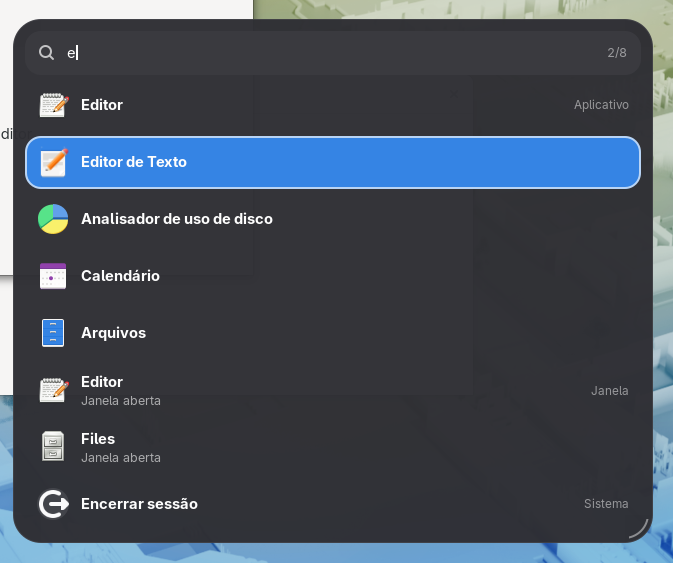
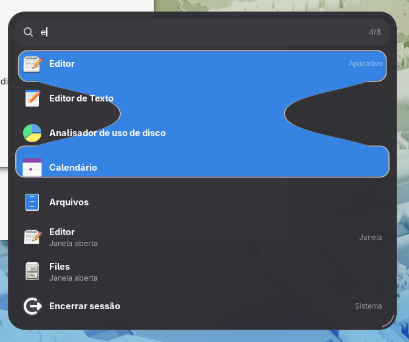
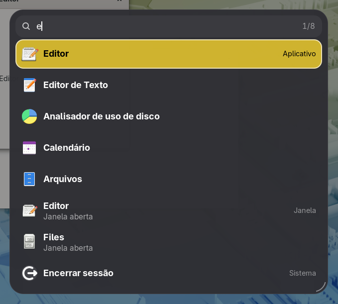
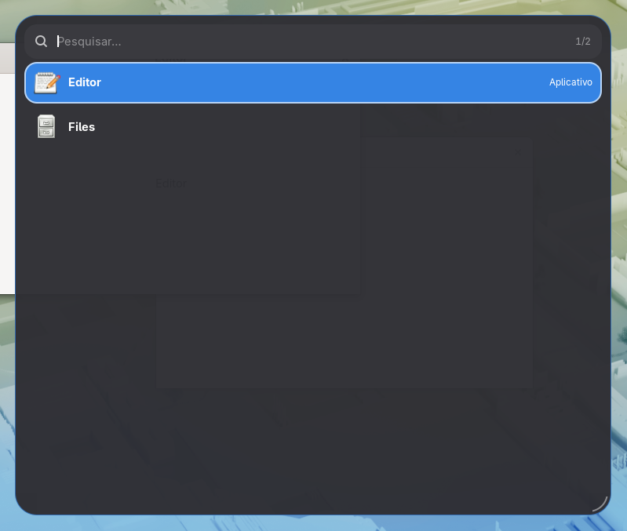
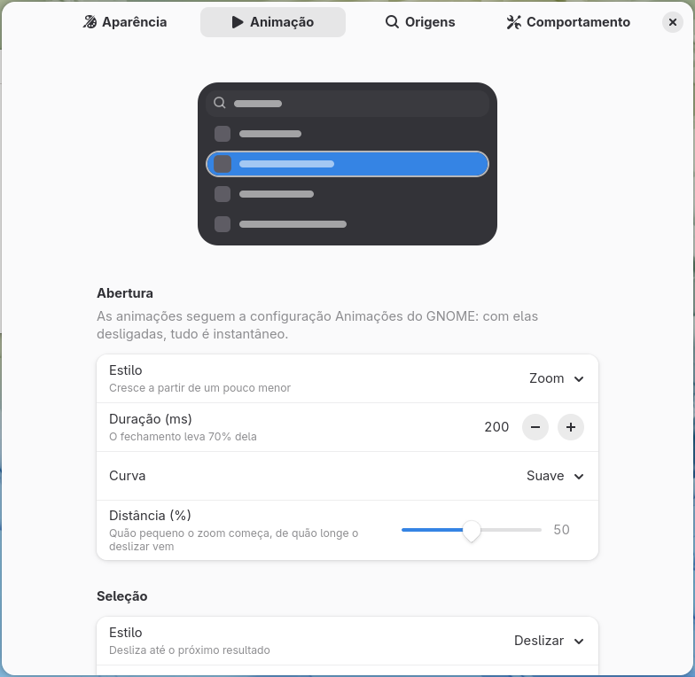
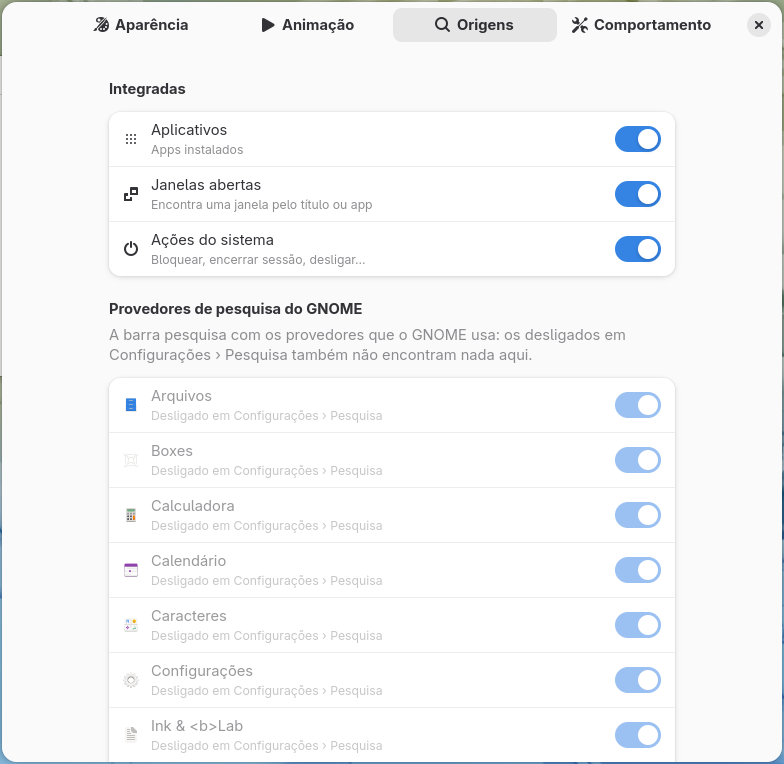

# Search Bar

A rofi-style search bar for GNOME Shell. Press a shortcut, type, and press Enter: it finds apps, open windows, system actions and everything GNOME's own search providers find (files, settings, calculator, characters…), in one keyboard-driven list. You can drag it anywhere, resize it with its corner grip, choose which sources it searches, and tune how it looks and moves. It uses GNOME's search providers as the overview loaded them, so it follows Settings › Search and parental controls like the overview does.

<table>
  <tr>
    <td></td>
    <td></td>
  </tr>
  <tr>
    <td align="center"><b>Searching: apps, windows and system actions in one list</b></td>
    <td align="center"><b>The liquid selection style, mid-move</b></td>
  </tr>
  <tr>
    <td></td>
    <td></td>
  </tr>
  <tr>
    <td align="center"><b>Custom color, text size and a darkened screen</b></td>
    <td align="center"><b>Resizing with the corner grip</b></td>
  </tr>
  <tr>
    <td></td>
    <td></td>
  </tr>
  <tr>
    <td align="center"><b>Animation preferences with the live preview</b></td>
    <td align="center"><b>Choosing what it searches</b></td>
  </tr>
</table>

The screenshots are taken by the [smoke test](#smoke-test-buildsh-test) in a headless GNOME Shell. The preferences in them are in Brazilian Portuguese, one of the bundled translations.

## Contents

- [Features](#features)
- [Requirements](#requirements)
- [Installation](#installation)
- [Usage](#usage)
- [Settings](#settings)
- [How it works](#how-it-works)
- [Performance](#performance)
- [Project layout](#project-layout)
- [Building and packaging](#building-and-packaging)
- [Tests](#tests)
- [Development and debugging](#development-and-debugging)
- [Translations](#translations)
- [Project status](#project-status)
- [Ideas for later](#ideas-for-later)

## Features

- **One bar for everything:** apps, open windows (by title or app), system actions (lock, log out, power off…) and every GNOME search provider (Files, Settings, Calculator, Characters, Firefox…), merged in a fixed order.
- **Keyboard first, like rofi:** it opens with the keyboard in the field; arrows, Tab, Ctrl+N/P or Ctrl+J/K move, Enter opens, Escape closes. The list wraps around and scrolls only when the selection would leave it.
- **Choose the sources:** turn any built-in source or GNOME provider on or off, and set how many results each one and all of them may show.
- **Move and resize it with the mouse:** drag it by its edge or its magnifier; resize it with the grip at the bottom-right corner (rows snap to whole rows). Both are saved, or last only until it closes, as you prefer.
- **Where it opens:** center, top, bottom or a custom place, on the monitor under the pointer, of the focused window or the primary one.
- **Before typing:** your most used apps, or nothing.
- **Animated, and tunable:**
  - opening and closing: zoom, slide, unfold, fade or none, with its own duration, curve and distance; closing takes 70% of the time and never bounces;
  - the selection highlight: slide, stretch, liquid, jelly, pop, fade or none, with a speed curve (smooth, overshoot, bounce, elastic, linear), an adjustable rebound and fine-tuning per style;
  - the list grows and shrinks smoothly and new rows fade in; the selected icon grows;
  - every animation can be interrupted and continues from what is on screen.
- **Look:** accent or custom color, highlight opacity, border and radius, bar radius and opacity, icon and text size, descriptions and source labels on or off, and an optional darkened screen behind it.
- **Live preview** in the preferences: a miniature bar that selects its rows, closes and opens again, with the same motion code as the real one.
- **Costs nothing while closed:** the bar is built when it opens and destroyed when it closes; in between, the extension is one keybinding.
- **Follows GNOME's Animations setting:** with animations off, everything is instant.
- **HiDPI:** works with interface scale 2× and up.
- **Screen readers:** each result has an accessible name, the selected one is announced as you move, and the number of results is said once the search settles, while the keyboard stays in the field.
- **Translations** for Brazilian Portuguese and Spanish.

## Requirements

### To use and build

| Package (Fedora) | Version | Provides | Used for |
|---|---|---|---|
| `gnome-shell` | 50 | GNOME Shell and the `gnome-extensions` command | Running, enabling and packing the extension |
| `gjs` | the one shipped with GNOME | GNOME's JavaScript interpreter | Running the extension, the preferences and the unit tests |
| `glib2` | any recent | `glib-compile-schemas` | Compiling the settings schema |
| `gettext` | any recent | `msgfmt`, `xgettext`, `msgmerge` | Compiling and updating translations |

`gnome-shell` and `gjs` come with any GNOME installation. The scripts need `bash`.

### To test and develop

| Package (Fedora) | Provides | Used by |
|---|---|---|
| `dbus-daemon` | `dbus-run-session` | `./build.sh test`, `bench` and `dev`, which give the test GNOME Shell its own D-Bus bus |
| `dbus-tools` | `dbus-update-activation-environment` | `./build.sh test`, to pick the preferences page in screenshots |
| `gtk4` | GTK 4 for `gjs` | `./build.sh test` and `bench`, whose test windows are a tiny GTK app |
| `python3-pillow` | image comparison | `./build.sh test`, to check that the preferences preview moves |
| `mutter-devkit` | the window that hosts the nested session | `./build.sh dev` |

Fedora does not install `dbus-daemon` by default because it uses `dbus-broker` as the system bus. Both can be installed side by side: `dbus-daemon` only runs when `dbus-run-session` starts it.

### Summary by command

| Command | Needs |
|---|---|
| `./build.sh`, `install`, `stage`, `pack`, `pot`, `prefs` | `gnome-shell`, `gjs`, `glib2`, `gettext` |
| `./build.sh unit` | `gjs` |
| `./build.sh test`, `bench` | the first row, plus `dbus-daemon`, `dbus-tools`, `gtk4` and `python3-pillow` |
| `./build.sh dev` | the first row, plus `dbus-daemon` and `mutter-devkit` |

On Fedora, everything at once:

```sh
sudo dnf install gnome-shell gjs glib2 gettext dbus-daemon dbus-tools gtk4 python3-pillow mutter-devkit
```

On Debian or Ubuntu, the build and unit tests need `gjs libglib2.0-bin gettext`.

## Installation

### From source

```sh
git clone https://github.com/wvmj-dev/search-bar.git
cd search-bar
./build.sh install
```

This compiles the schema and translations and copies the extension to `~/.local/share/gnome-shell/extensions/search-bar@wvmj-dev.github.io`.

Then:

1. **Log out and back in.** On Wayland, GNOME Shell only loads new extensions, or new code of an extension, on a new login.
2. Enable the extension, either from the **Extensions** app or with:

   ```sh
   gnome-extensions enable search-bar@wvmj-dev.github.io
   ```

### From the `.zip`

```sh
./build.sh pack
gnome-extensions install --force search-bar@wvmj-dev.github.io.shell-extension.zip
```

Then follow steps 1 and 2 above.

### Uninstalling

```sh
gnome-extensions uninstall search-bar@wvmj-dev.github.io
```

## Usage

| Key | Effect |
|---|---|
| <kbd>Super</kbd>+<kbd>/</kbd> | Opens the bar; again, closes it (changeable in the preferences) |
| typing | Searches every enabled source |
| <kbd>↓</kbd>, <kbd>Tab</kbd>, <kbd>Ctrl</kbd>+<kbd>N</kbd>, <kbd>Ctrl</kbd>+<kbd>J</kbd> | Next result; from the last one, back to the first |
| <kbd>↑</kbd>, <kbd>Shift</kbd>+<kbd>Tab</kbd>, <kbd>Ctrl</kbd>+<kbd>P</kbd>, <kbd>Ctrl</kbd>+<kbd>K</kbd> | Previous result; from the first one, to the last |
| <kbd>Page Down</kbd>, <kbd>Page Up</kbd> | A page of results down or up |
| <kbd>Enter</kbd> | Opens the selected result: launches or focuses an app, focuses a window, runs an action, or lets its provider open it (a file, a setting…). Typed fast and pressed at once, it opens the first result of what was typed, never one left from before |
| <kbd>Esc</kbd> | Closes the bar |

| Mouse | Effect |
|---|---|
| pointing at a result | Selects it (can be turned off) |
| click on a result | Opens it |
| wheel | Moves the selection, without wrapping |
| drag the bar's edge or its magnifier | Moves the bar |
| drag the grip at the bottom-right corner | Resizes it: width, and rows in whole steps |
| click outside | Closes the bar (can be turned off) |

The counter at the right of the field shows the selected result and how many there are, like rofi's.

## Settings

Open the preferences from the **Extensions** app or with:

```sh
gnome-extensions prefs search-bar@wvmj-dev.github.io
```

**Appearance page**, with a live preview at the top
- *Size:* width, rows shown, icon size, text size, descriptions and source labels;
- *Highlight:* custom color, opacity, corner radius, border width, size of the selected icon;
- *Bar:* corner radius, background opacity, darkening the screen behind.

**Animation page**, with the same live preview
- *Opening:* style, duration, curve and distance;
- *Selection:* style, duration, curve and rebound (greyed out where the style does not use them);
- *Fine-tuning:* only the rows of the chosen style (stretch reach; liquid viscosity; jelly bounce, wobbles and stretch; pop size);
- *Results:* animating the list.

**Sources page**
- apps, open windows and system actions;
- one switch per GNOME search provider installed, with its icon; providers GNOME itself does not use (turned off in Settings › Search, off by default, or all of them with "disable external") are greyed out with "Turned off in Settings › Search", and a button opens that page of GNOME Settings.

**Behavior page**
- *Opening:* the shortcut (press the keys to use, with Ctrl, Alt or Super; a Disable button turns it off), monitor, closing on a click outside;
- *Position:* center, top, bottom or custom (with its place in percent), saving what the mouse changes, resetting position and size;
- *Search:* what shows before typing, results per source and in all, delay after the last key, selecting under the pointer;
- resetting everything to defaults.

| GSettings key | Type | Default | Description |
|---|---|---|---|
| `width` | `i` (320–1600) | `640` | Width of the bar in pixels |
| `visible-rows` | `i` (1–20) | `8` | Most results shown at once; more scroll |
| `icon-size` | `i` (16–64) | `32` | Size of the results' icons; a row is as tall as the icon or the text, whichever is taller, plus 16 px |
| `font-size` | `i` (0–32) | `0` | Text size in pixels; 0 uses the theme's |
| `show-descriptions` | `b` | `true` | Second line under each result |
| `show-source` | `b` | `true` | Where results come from, on the right of the first result of each source |
| `highlight-color` | `s` | `''` | Color as `#rrggbb`; empty uses the system accent color |
| `highlight-opacity` | `i` (10–100) | `100` | Opacity of the highlight in percent |
| `corner-radius` | `i` (0–32) | `16` | Corner radius of the highlight |
| `border-width` | `i` (0–6) | `2` | Width of the highlight's light border; 0 for none |
| `focus-scale` | `i` (100–130) | `110` | Size of the selected result's icon in percent; 100 turns it off |
| `panel-radius` | `i` (0–48) | `28` | Corner radius of the bar |
| `panel-opacity` | `i` (50–100) | `97` | Opacity of the bar's background in percent |
| `backdrop-opacity` | `i` (0–80) | `0` | How much the screen behind darkens, in percent |
| `open-animation` | `s`: `zoom`, `slide`, `unfold`, `fade`, `none` | `'zoom'` | How the bar appears (and, backwards, disappears) |
| `open-duration` | `i` (50–1000) | `200` | Length of the opening in ms; closing takes 70% |
| `open-curve` | `s`: `smooth`, `overshoot`, `bounce`, `elastic`, `linear` | `'smooth'` | Speed curve of the opening |
| `reveal-amount` | `i` (0–100) | `50` | How small zoom starts, how far slide travels, how folded unfold starts |
| `animation` | `s`: `slide`, `stretch`, `liquid`, `jelly`, `pop`, `fade`, `none` | `'slide'` | How the highlight moves to the selected result |
| `animation-duration` | `i` (50–1000) | `220` | Length of the highlight's movement in ms |
| `animation-curve` | `s`: as `open-curve` | `'overshoot'` | Speed curve of the highlight (not for liquid, jelly, none) |
| `curve-rebound` | `i` (0–100) | `50` | How far overshoot, bounce and elastic go; 50 is the usual amount |
| `stretch-reach` | `i` (20–70) | `40` | Share of the stretch spent reaching over both results |
| `liquid-viscosity` | `i` (0–100) | `50` | How liquid the drop is |
| `jelly-bounce` | `i` (0–100) | `50` | How much the jelly bounces |
| `jelly-wobbles` | `i` (1–4) | `2` | How many times it wobbles |
| `jelly-stretch` | `i` (0–60) | `30` | How much it stretches while moving |
| `pop-size` | `i` (0–80) | `30` | Size pop shrinks to before jumping |
| `animate-results` | `b` | `true` | The list grows and shrinks smoothly, new rows fade in |
| `search-bar-toggle` | `as` | `['<Super>slash']` | Shortcut that opens and closes the bar |
| `monitor` | `s`: `pointer`, `focused`, `primary` | `'pointer'` | Monitor the bar appears on |
| `position` | `s`: `center`, `top`, `bottom`, `custom` | `'center'` | Where the bar appears; dragging it sets `custom` |
| `custom-x` | `d` (0–100) | `50` | Custom place across, in percent of the free space |
| `custom-y` | `d` (0–100) | `30` | Custom place down, in percent of the free space |
| `remember-geometry` | `b` | `true` | Save the position and size changed with the mouse |
| `close-on-click-outside` | `b` | `true` | Close on a click outside the bar |
| `empty-query` | `s`: `frequent`, `nothing` | `'frequent'` | What shows before anything is typed |
| `results-per-source` | `i` (1–20) | `5` | Most results of one source |
| `max-results` | `i` (5–100) | `30` | Most results in all |
| `search-delay` | `i` (0–500) | `100` | Wait after the last key before searching, in ms |
| `select-on-hover` | `b` | `true` | Select the result under the pointer |
| `disabled-sources` | `as` | `[]` | `applications`, `actions`, `windows`, or a provider's desktop id such as `org.gnome.Nautilus.desktop` |

The keys can also be changed from a terminal:

```sh
SCHEMA=org.gnome.shell.extensions.search-bar
DIR=~/.local/share/gnome-shell/extensions/search-bar@wvmj-dev.github.io/schemas

gsettings --schemadir "$DIR" set $SCHEMA animation "'liquid'"
gsettings --schemadir "$DIR" set $SCHEMA disabled-sources "['windows', 'org.mozilla.firefox.desktop']"
```

## How it works

### Built when it opens, gone when it closes

[extension.js](extension.js) registers one keybinding with `Main.wm.addKeybinding` and nothing else. The shortcut creates a `SearchBar` ([bar.js](bar.js)) with the settings read into plain values at that moment, and the bar destroys itself when its closing animation ends. It never opens over a dialog, a menu or the lock screen (`Main.actionMode` must be `NORMAL` or `OVERVIEW`). `disable()` takes it down at once even mid-animation: it releases the grab, cancels the searches and destroys every actor. The smoke test checks this.

An error must never leave the desktop covered or grabbed:
- the full-screen layer is created non-reactive and only `open()` makes it take clicks;
- if the constructor throws after the layer is on the stage, it takes the layer down before passing the error on;
- `destroy()` releases the grab first and removes the layer in a `finally`, so an error while stopping an animation cannot stop either;
- `toggle()` destroys a bar whose `open()` threw.

The smoke test injects each of these errors.

### The layer, the grab and the keyboard

The bar lives in a full-screen `St.Widget` in `Main.layoutManager.uiGroup`, with an optional darkened backdrop under it. The backdrop exists only when `backdrop-opacity` is above 0: an invisible full-screen actor faded in and out with the bar would repaint the whole screen on every frame of the opening and closing. Clicks outside the bar land on the layer itself, with or without it. `Main.pushModal(layer, {actionMode: POPUP})` gives it the keyboard and the pointer. `POPUP` keeps the toggle shortcut working, so it can close the bar again. The modal is released as soon as closing starts, not when the animation ends, so a dialog that an activated result opens (Power Off asks first) gets the keyboard at once. The field's `key-press-event` handles navigation before `St.Entry` sees the keys. Clicks are matched to actors with `global.stage.get_event_actor(event)`, because `ClutterEvent.get_source()` is always `null` in GNOME 50.

### Sizes from code, not from the theme

Every size comes from [layout.js](layout.js) in physical pixels (logical × scale factor), and the bar's height is that of all its rows. A row is as tall as the taller of its icon and its text, plus padding. The text's height is the one thing measured from the theme: when the bar opens, a hidden probe with a name and a description is measured inside the bar, so the chosen text size applies. Large text with small icons therefore never pushes the second line into the next row. The bar is placed as if all rows showed, so **the search field never moves** while results come and go: only the bottom edge grows and shrinks (eased, when `animate-results` is on). The bar remembers the height it is at or easing to: every source's answer asks for a height again, and the same one changes nothing, so an ease runs once instead of restarting with each answer. Moving the selection never refits (it does not change which rows show), so it cannot cut an ease short. The first results, which arrive while the bar is still opening, take their height at once instead of easing on top of the opening. The bar clips to its own allocation, so rows fading in while it grows never show outside it.

### Searching: GNOME's own providers

[sources.js](sources.js) does not load providers itself. It reuses the overview's: `SearchResultsView._providers`, reached through `Main.overview._overview.controls._searchController._searchResults`. These already follow Settings › Search (sources turned off, their order, "disable external") and parental controls, and reusing them starts no D-Bus proxies of its own. For each enabled provider it calls `getInitialResultSet()`, or `getSubsearchResultSet()` when the new text only extends the old one (as the overview does), then `filterResults()` and `getResultMetas()`, all with a `Gio.Cancellable` that every new search cancels. Results are merged by [query.js](query.js) in a fixed order of sources (apps, windows, system actions, then the providers in GNOME's order), so the list does not reshuffle as slower providers answer. A generation counter drops answers to an old search. Most providers find nothing for most searches, so an answer that changes no source's results is not reported: only the first report of a search, a change, the apps and system actions coming in (which Enter waits for) and the last answer (which ends "Searching…") redraw the list.

- **Apps and system actions** come from GNOME's `AppSearchProvider`, split by id: `.desktop` ids are apps, the rest are actions.
- **Frequent apps** (before typing) come from `Shell.AppUsage`, filtered like the overview's app grid: apps hidden by their `.desktop` file or denied by the user's parental controls (`ParentalControlsManager.shouldShowApp()`) are left out.
- **Windows** are matched in [query.js](query.js): every term must appear in the title or the app's name, ignoring case and accents, and a match at the start of a word ranks higher. A window's second line is its app's name, or "Open window" when the title is the app's name, so a window never looks exactly like its app's row.
- **Opening** a result: `Shell.App.activate()` for apps, `Main.activateWindow()` for windows, `SystemActions.activateAction()` for actions, and the provider's `activateResult()` for the rest. Under `SEARCH_BAR_DRY_RUN` (set by `./build.sh dev` and the tests), system actions only log, because the nested and headless shells share the machine's system bus.

The Sources page of the preferences reads the same choice as the overview (`org.gnome.desktop.search-providers`: `disable-external`, `disabled`, `enabled`, and `DefaultDisabled` in each provider's `.ini`, as `loadRemoteSearchProviders()` does, through `gnomeSearches()` in [query.js](query.js)), and lists only providers of apps GNOME shows. A provider GNOME leaves out finds nothing in the bar either, so its row is greyed out and says so instead of looking on. Its button runs `gnome-control-center search` with `Gio.Subprocess` and a fixed argv, no shell.

Titles, names and descriptions come from other programs, so they are shown with `St.Label.text` (plain text), never as markup. In the preferences, the rows that show providers' names from their `.desktop` files are created with `use_markup: false`. A provider's answer is checked first, as the overview does: a result without an id or a name is dropped, an id that is not a string too, and every name, description and window title becomes a string of at most 512 characters (`labelText()` in [query.js](query.js)), whatever type it was sent as and however long it was.

### Long text stays cheap

Everything typed is split, folded and matched against every window, and sent to every provider, on the shell's only thread. A pasted log of megabytes would freeze the desktop for as long as that takes. So the field takes at most 512 characters (`max_length` of its `ClutterText`, `MAX_TEXT` in [query.js](query.js)), and `termsFor()` keeps at most 16 terms (`MAX_TERMS`). The smoke test pastes 3 MB of words and checks that it takes under 250 ms.

### Enter never opens an old result

The search waits for the typing to pause (`search-delay`) and the sources answer later, so for a moment the list on screen belongs to a few keys ago. That list could start with the first frequent app or a system action. Each report from [sources.js](sources.js) therefore says which terms it is for and whether the apps and system actions (GNOME's local provider) are in. When Enter comes while the list does not match the text, [bar.js](bar.js) runs the waiting search at once, as GNOME's overview does in `SearchResultsView.activateDefault()`. It then opens the first result of that search as soon as the local sources have found something, or when every source has answered. It waits at most 500 ms, and if nothing was found, nothing opens. A click opens the result shown in the clicked row, even if the list changed between press and release. Results from GNOME's providers are opened with the terms they were found with.

New text puts the selection back on the first result, like rofi. Within one search, a result the user moved to stays selected while other sources answer.

### Screen readers

The keyboard never leaves the field, so typing works like rofi's; the bar follows GNOME's Alt+Tab switcher and the overview's highlighted first result, which do the same:

- **Each row has an accessible name**, "name, description, source" (`spokenLabel()` in [query.js](query.js)), set in `_fillRow()`. A row is an `St.Button` without a label, so without it the name would be empty. The source is in every row's name, although its label shows only on a source's first row: a screen reader hears one row at a time. The rows keep the button role: Orca ignores name changes on list items, and would count positions from reused row actors.
- **The selected row is announced through the SELECTED accessible state.** St turns the `selected` style pseudo-class into ATK's SELECTED state, and Orca's GNOME Shell script moves its focus point to the row that becomes selected and reads it. Rows are reused while scrolling, so when the selected row stays the same but shows another result, the pseudo-class does not change; [bar.js](bar.js) then removes and adds SELECTED (`remove_accessible_state()`, `add_accessible_state()`), which signals the change again.
- **The count, "Searching…" and "No results"** are sent as a polite live-region notification on the field's accessible (`AtkObject::notification` with `Atk.Live.POLITE`, ATK 2.50 and later), which the AT-SPI bridge passes on as `object:announcement`. Several sources answer one search, so it is sent only once the reports have paused for 500 ms, and never the same text twice in a row; clearing the text forgets the last one. The timeout is removed when the bar closes or is destroyed. The visible counter and status are plain labels, which Orca does not read outside a dialog, so nothing is said twice.

The smoke test checks the names, the state on the selected row only (also on a reused row), the notification and its timing through the ATK objects inside the shell; Orca itself cannot run there (see [Manual checks](#manual-checks)).

### Text on a custom color

With a custom highlight color, the selected row's text is black or white, whichever reads better. The highlight is translucent below 100% opacity, so the choice is made on the color it shows over the bar: `blendOver()` in [color.js](color.js) mixes it with the bar's surface (#2e2e33) by the opacity first. A yellow at 20% looks dark there and gets white text. With the system accent color, GNOME's own accent text color is used.

### Rows and scrolling like rofi

The bar keeps one row actor per visible place and changes their contents as the list scrolls. `scrollOffset()` moves the view only when the selection would leave it, like rofi. A row that appears under a still pointer does not take the selection: hovering selects only after the pointer has moved. Where results come from shows once per run of results from the same source, on its first row (and on the top row, whose run may have started above the view), not on every row.

Every report brings new result objects, even for the same results, so a row compares what it shows by key (`resultKey()` in [query.js](query.js): kind, source and id) plus the texts, and is refilled only when they changed. Icons are kept by key while the bar is open: a row that shows a result again, after scrolling away and back or when another source answers, takes the same icon actor instead of building a new texture. Icons of results that are gone are destroyed on the next report, and all of them when the bar closes. A provider's icon that throws costs that icon only; the error is logged and the list goes on.

### The highlight: the transition engine, turned vertical

The highlight behind the selected row and its animation come from Alt Tab Glide's engine ([geometry.js](geometry.js), [drawing.js](drawing.js)), with one addition: a `vertical` option. A vertical transition runs the horizontal one with x and y swapped and swaps the result back. Every style (stretch's reach, liquid's head and tail, jelly's squash) therefore works down a list without being written twice. The liquid drop keeps its shape in swapped coordinates, and `paintShape()` swaps them back with a quarter turn and a flip (`rotate(π/2)` then `scale(1, −1)` maps (x, y) to (y, x)). One `Clutter.Timeline` per move applies `at(t)` each frame. `paintShape()` paints into a cairo group only when the highlight is translucent, so its opacity applies once; an opaque one (the default) skips that extra surface on every frame. A new move starts from where the highlight is on screen, including its opacity, so an interrupted fade never flashes. New search results put it on the first row without a trip.

| Curve | Definition |
|---|---|
| smooth | `1 − (1 − t)³` |
| overshoot | `1 + (c+1)(t−1)³ + c(t−1)²`, `c` = 3.4 × rebound (1.70158 at 50) |
| bounce | a ball under gravity, 6 bounces with restitution 0.2–0.8, landing exactly at 1 |
| elastic | `1 − a e^(−kt) cos(4.5πt)(1−t) − (1−a)(1−t)³` |
| linear | `t` |

### Opening and closing

[reveal.js](reveal.js) turns a reveal value (0 hidden, 1 shown, past 1 while overshooting) into opacity, scale, pivot and offset: zoom grows from 90% at the default distance, slide drops 48 px, unfold opens from the top edge. `revealMotion()` always starts from the current value, so pressing the shortcut while the bar closes reopens it from where it is. Closing accelerates away (`v₀(1 − t²)`) and never rebounds.

### Moving and resizing

Pressing on the bar's edge, the field's frame or the magnifier starts a move; pressing on the grip starts a resize. The pointer shows it: a move cursor over the edge and the magnifier, a resize cursor over the grip, the text cursor over the field and the arrow over the results (`set_cursor_type()` on each part; while dragging, every part and the layer show the drag's cursor, and they go back on release). A press becomes a drag only after the pointer has moved 4 px, and only a place or size that really changed is saved, so a click on the magnifier never turns a centered bar into a custom one. The grip is a mark along the bar's rounded corner, drawn with cairo (St cannot paint a two-sided rounded border) and repainted only when the pointer enters or leaves it, when it turns thicker and accent-colored. While dragging, the layer's `captured-event` follows the pointer anywhere on the screen. A move is kept inside the work area. A resize snaps to whole rows and shows all of them while the button is down. On release, [layout.js](layout.js) turns the place into percentages of the free space (`customFromPlace()`), which `placeBar()` restores to the pixel and which stay right when the resolution changes. They are saved only if `remember-geometry` is on, in one write to dconf (`delay()` then `apply()` on the settings) rather than one per key.

### The shortcut editor

The shortcut is global, so a plain key (a letter, Backspace, Enter) would be taken from every app. [shortcut.js](shortcut.js) accepts a key only with Ctrl, Alt or Super (Shift alone still types), except keys that do nothing while typing: F1 to F35, Print, Pause, Scroll Lock and media keys, as GNOME Settings does. A refused key leaves the dialog open and says why in its body (plain text, not markup). Turning the shortcut off is the dialog's Disable button, not a key. Tab and Enter still reach the buttons, so the dialog works from the keyboard.

### The live preview

[preview.js](preview.js) draws a miniature bar in a `Gtk.DrawingArea` with the same `makeTransition()`, `revealFrame()` and `paintShape()` as the shell, so it cannot drift from the real motion. It runs on a tick callback, which only runs while it is visible, and restarts on every setting change. The callback runs only while something moves: in the pauses between moves (650 ms after each) it draws the final frame, removes itself and sets a timeout for the end of the pause, so a preferences window left open does not redraw the same picture every frame. The timeout goes when the preview is hidden or destroyed.

## Performance

**While closed, the extension does nothing:** one keybinding and one `monitors-changed` handler (which closes an open bar). No timers, no actors, no signals on anything that changes often. The `captured-event` handler that tracks the pointer exists only while the bar is open.

Measured with `./build.sh bench` on an AMD Ryzen 7 7735HS (16 threads), Fedora 44, GNOME Shell 50.6, in a headless 1280×800 session. Each "searching" row opens the bar, searches for "e" and moves the selection 40 times, 0.25 s apart, then closes it. The Evals that drive it are measured on their own in the control row: the same calls at the same pace, doing nothing.

| What | CPU of `gnome-shell` |
|---|---|
| idle, extension disabled | 0.4% of a core |
| idle, extension enabled | 0.5% of a core |
| the same Evals, doing nothing (control) | 1.4% |
| searching, 40 moves, no highlight animation | 11.5% |
| searching, 40 moves, slide (default) | 14.9% |
| searching, 40 moves, liquid (cairo) | 19.1% |

- **Closed, it is free:** the same as the extension disabled, within measuring noise.
- **Driving the shell costs little:** about 1.4 points of the searching rows are the test's own D-Bus calls.
- **The highlight's motion** costs about 3.5 points of a core while the selection moves every quarter second. Liquid draws a cairo shape each frame and costs about 4 points more. Choose `none`, or a shorter duration, to save the most.
- These rows are about 3 points higher than an earlier measurement on the same machine; the version before the row keys, icon cache and height fixes measured the same as this one on the same day (14.5%, 19.1% and 11.7%), so the difference is the machine's state, not the code. This scripted interaction mostly jumps across the list, so it does not show the savings of reusing rows and icons when sources answer.

Memory (resident size of `gnome-shell` after garbage collection):

| Rounds of 30 open, search, close | Change |
|---|---|
| 1 | +3872 KiB |
| 2 | −8 KiB |
| 3 | +1300 KiB |
| 4 | +2604 KiB |

The size before each round stayed between 264 and 266 MiB, so the changes are noise of a few MiB rather than a growth that adds up; a second run gave +3092, +2200, −1340 and +1808 KiB. 50 disable/enable cycles per round changed it by −2080, +80, +40 and +188 KiB: no leak.

Run it on your machine with `./build.sh bench`.

## Project layout

```
search-bar/
├── metadata.json          # UUID, supported versions, schema and gettext domain
├── extension.js           # Keybinding, settings read on opening, enable/disable
├── bar.js                 # The bar: layer, field, rows, highlight, drag, resize, reveal (shell)
├── sources.js             # Searching GNOME's providers and open windows, opening results (shell)
├── query.js               # Terms, window matching, merging results, moving the selection (pure)
├── layout.js              # Sizes, placing, saving a dragged place, resizing, scrolling (pure)
├── reveal.js              # Opening and closing motion (pure)
├── geometry.js            # Highlight transitions and curves, horizontal and vertical (pure)
├── drawing.js             # Cairo painting of the highlight and the liquid drop (pure)
├── color.js               # Custom color validation and contrast (pure)
├── shortcut.js            # Which key combinations make a shortcut (pure)
├── prefs.js               # Preferences window (GTK 4 + libadwaita)
├── preview.js             # Live preview in the preferences
├── stylesheet.css         # Styles, prefixed with sb-
├── schemas/               # GSettings schema
├── po/                    # Template (.pot) and translations (pt_BR, es)
├── tests/
│   ├── unit.js            # Unit tests (gjs)
│   ├── smoke.sh           # Test in a headless session, with screenshots; also ./build.sh bench
│   ├── app/               # Tiny GTK app that gives the smoke test real windows
│   └── devtools/          # Helper extension used only by the smoke test
├── docs/screenshots/      # Screenshots used in this README
├── .github/workflows/     # CI
└── build.sh               # Building, installing, testing, packing and translations
```

"Pure" modules import nothing from GNOME Shell, so `gjs` unit tests and the preferences can load them.

`schemas/gschemas.compiled`, `locale/` and `tests/output/` are generated and not versioned. The `.zip` from `./build.sh pack` contains only the extension files.

**To add a built-in source:** add its id to `BUILTIN_SOURCES` in [query.js](query.js), produce its results in `Searcher._search()` with `{id, name, description, createIcon, kind, sourceName}`, open them in `Searcher.activate()`, and add a switch on the Sources page.

**To add an opening style:** add it to `REVEALS` and `revealFrame()` in [reveal.js](reveal.js), to the schema's `<choices>`, and to the Animation page with a one-line description. The unit tests check that the lists match.

## Building and packaging

| Command | What it does |
|---|---|
| `./build.sh` | Compiles the schema (strict mode) and the translations in place |
| `./build.sh install` | Builds and installs to `~/.local/share/gnome-shell/extensions/<uuid>` |
| `./build.sh stage DIR` | Builds and copies the extension to `DIR/<uuid>` (used by the tests) |
| `./build.sh unit` | Runs the unit tests |
| `./build.sh test` | Runs the unit tests and the headless smoke test, without installing anything in your session |
| `./build.sh bench` | Measures the shell's CPU and memory with the extension, in the same kind of throwaway session |
| `./build.sh dev` | Installs and opens a nested GNOME Shell in a window |
| `./build.sh prefs` | Installs and reopens the preferences window with the new `prefs.js` |
| `./build.sh pack` | Creates `<uuid>.shell-extension.zip` for [extensions.gnome.org](https://extensions.gnome.org) |
| `./build.sh pot` | Updates the `.pot` and the `.po` files from the code |

The list of extension files lives in one variable (`SOURCES` in `build.sh`), used by `install`, `stage`, `pack` and `pot`. A new file only needs to be added there.

## Tests

| Level | Command | Time | Covers |
|---|---|---|---|
| Unit | `./build.sh unit` | ~1 s | The pure modules: transitions, drawing, layout, search, reveal, schema |
| Smoke (headless) | `./build.sh test` | ~1.5 min | The extension and the preferences running in a real GNOME Shell, driven by a virtual keyboard and pointer, with screenshots |
| CI | automatic on GitHub | ~1 min | Schema, translations, an up-to-date `.pot` and the unit tests |

### Unit tests: `./build.sh unit`

[tests/unit.js](tests/unit.js) loads the modules without GNOME Shell imports straight into `gjs`: 461 checks.

- **Schema:** every key has a summary, defaults are inside their ranges and choices, the bar opens with the smooth curve while the highlight keeps overshoot, and the lists in code (styles, curves, opening styles, positions, monitors) and the tuning defaults match the schema.
- **Transitions in a vertical list:** every style × every curve × default, lowest and highest tuning, sampled at 101 points: ends exactly on the target, never inside out, opacity within 0–1. A vertical slide moves along y only, the liquid's head leads its tail downwards, an interrupted fade starts transparent, more rebound overshoots further.
- **Pixels:** a vertical drop painted with cairo covers the head, the tail and the bridge between them and leaves the corners empty; a box painted at full opacity (no cairo group) has a solid fill and its border at the border's alpha, and at half opacity both are halved.
- **Layout:** row and bar sizes, doubling at scale 2, the four positions, custom places always inside the monitor, a dragged place saved and restored to the pixel, resizing in physical pixels snapped to whole rows within the schema's ranges, rofi-like scrolling.
- **Search:** which providers GNOME uses, from `disabled`, `enabled`, `disable-external` and a provider's `DefaultDisabled`; texts from other programs always strings and cut at 512 characters, never inside a character; terms as GNOME splits them, at most 16 of them from at most 512 characters (a pasted megabyte of words is split in well under 20 ms), sub-searches, accent- and case-insensitive window matching ranking word starts first, merging in source order with per-source and total limits, the name a screen reader says for a row, selection wrapping (but not for the wheel or a page).
- **Reveal:** every opening style is fully shown at 1 and invisible at 0, never a zero scale; opening ends exactly open and can overshoot, reopening starts where it was, closing never rebounds.
- **Shortcut:** `<Super>slash`, `<Shift>F5`, F1, F12, Print and media keys are accepted; a letter, Backspace, Enter, Space, Home or Shift with a letter alone are not.
- **Colors:** `parseColor()` accepts only `#rrggbb` (`'#3584e4; color: red'` is rejected), contrast text color, and blending a translucent color over the bar (yellow at 80% takes dark text, at 20% light text).

### Smoke test: `./build.sh test`

[tests/smoke.sh](tests/smoke.sh) runs the extension in a **headless** GNOME Shell (no window, no screen) with test windows from a tiny GTK app ([tests/app/](tests/app/)). Keys and mouse go through **virtual input devices**, so they take the same path as real ones: the shortcut through GNOME's keybindings, arrows and Enter through the field, drags through the stage. It saves screenshots in `tests/output/`, and fails on any JavaScript error, in the shell or in the preferences, or failed check.

| # | Scenario | Checks |
|---|---|---|
| 1 | Enabled, closed | The shortcut is registered and nothing else exists |
| 2 | <kbd>Super</kbd>+<kbd>/</kbd> | The bar opens modal, centered, 640 px wide, with the keyboard in the field; with the screen not darkened (the default), no backdrop actor exists. Fails if the backdrop is always built |
| 3 | Typing "edi" | The Editor app and the Editor window are found, and the window's row (titled like its app) has a second line of its own; the source label shows only on the first row of each source; the highlight lies on the first row within 1.5 px; counter; the selected icon grew to 110% |
| 3b | <kbd>↓</kbd> twice, then a key | New text puts the selection back on the first result |
| 3c | Pasting 3 MB of words into the field | The field keeps at most 512 characters, the search uses at most 16 terms, the paste takes under 250 ms, and the bar still searches and moves the selection afterwards. Fails without either limit |
| 3d | Screen readers, through the ATK objects inside the shell | Each row's accessible name is "name, …, source", and the Editor window's includes its description; only the selected row has the SELECTED state, and it follows <kbd>↓</kbd>; with three rows, four <kbd>↓</kbd> give one SELECTED change per move, three of them on the last row while it scrolls; the keyboard stays in the field; the count is sent once as a polite notification, at least 490 ms after the last report, not again for the same results, then "No results" once, not repeated for another search with none; closing removes a waiting one. Each part is skipped, with a message, if the shell has no accessible objects. Fails without the names, the toggle on a reused row, the delay, the repeat check or the cleanup on close |
| 4 | <kbd>↓</kbd>, <kbd>↑</kbd>, <kbd>Esc</kbd> | The highlight follows and wraps both ways; the previous icon shrinks back; Escape closes and destroys everything |
| 4b | Typing a test app's name and <kbd>Enter</kbd> at once, with a 400 ms delay | Enter comes while the search still waits, yet it opens that app, not the first frequent app shown before typing. Fails if Enter opens the list on screen |
| 4c | Typing "xyzzy" and <kbd>Enter</kbd> at once | Nothing opens and nothing is left waiting |
| 4d | Parental controls denying the Editor test app | Before, both test apps are among the frequent apps; with the filter, the Editor is gone and Files is still there. Fails if only `should_show()` is checked |
| 5 | Every selection style at 900 ms | A screenshot mid-move; the liquid drop is showing; then the highlight settles on the row and the drop hides |
| 6 | Three rows, five Downs | The list scrolls like rofi's and the last row shows the selected result |
| 6b | Scrolling three rows down and back, the same results reported again, two providers that find nothing | The first row gets back the same icon actor; only the six rows that scrolling changed are refilled, and none for the same results again; the cache holds no more icons than results; the two empty providers cause one report (the last), not two. Fails without the row keys, the icon cache or the change check in [sources.js](sources.js) |
| 6c | Opening, then fewer results, a move and the same results again in one frame | No height ease on top of the opening; the ease that fewer results start is the very same transition after the move and after the same height is asked again, and it settles lower. Fails if the target is not remembered, if a move refits, or if the first results ease while opening |
| 7 | <kbd>Enter</kbd> on a window, on an action | The Editor window gets the focus; the system action is only logged (dry run) and the grab is released |
| 8 | Sources turned off | No windows when windows are off; only windows when apps and actions are off; "No results" for a search that finds nothing |
| 8b | A provider (injected into the overview's list) sends a number as a name, a result without an id, a 100 000-character name and an icon that throws | No exception; the three valid results show, the number as text, the long name and description cut to 512 characters; every row is filled, and the list still moves and searches again. Fails without the checks in `_searchProvider()` or the `try` around `createIcon()` |
| 9 | Dragging the edge | The bar follows the pointer exactly, the place is saved as custom in one write (counted by another settings object) and restored on the next opening. Fails without `delay()`/`apply()` |
| 10 | Dragging the grip | Width and rows follow in whole rows, the size is saved in one write and used on the next opening |
| 11 | Saving turned off | A move lasts until the bar closes and is not saved |
| 11b | A click on the magnifier, a 2 px wobble, then a real drag | The edge and magnifier have the move cursor, the grip the resize one, the field the text one and the list the arrow; the click and the wobble neither move the bar nor write any setting (position stays `center`); during the real drag the layer and the list show the move cursor, back to normal on release, and the place is saved. Fails without the threshold, the save check or the cursors |
| 12 | Click outside | Closing starts with the grab released, animates, then nothing is left |
| 13 | Every opening style at 900 ms | Animating mid-way (screenshot), then fully open with scale 1 and no offset; reopening while closing continues from where it was |
| 14 | Disable while open and animating | No actor, no grab, no shortcut left; the real shortcut opens the bar after enabling again |
| 14b | A keybinding left behind under the same name | The next enable still registers the shortcut and it opens the bar. Fails without the recovery in `enable()` |
| 14c | Errors injected in the constructor, in `open()` and in `destroy()` | Each time, no layer, grab or full-screen reactive actor is left and the number of actors in `uiGroup` is back where it was; the shortcut works again afterwards. Fails if the constructor or `destroy()` is not failure-safe |
| 15 | Custom look | Custom color with its opacity, dark text on a light color, light text on the same color at 20% (it shows dark over the bar), text size, darkened screen. Fails if the text color ignores the opacity |
| 15b | 16 px icons with 28 px text | Rows grow beyond the icon, and every row's name and description fit inside it, close together (also checked at the default size in 3 and at 18 px in 15). Fails if the row height ignores the text, or if the two lines sit 12 px apart |
| 16 | HiDPI (scale 2) | Width and row height double; the highlight still lies on its row |
| 17 | GNOME's animations off | Opening, selection and closing are instant |
| 18 | Default look | Screenshot for this README |
| 19 | Preferences | Every page opens without errors (screenshots); the live preview moves; a test search provider named `Ink & <b>Lab` (not valid markup) shows on the Sources page without a markup error; with the test's `disable-external`, every provider row is greyed out (screenshot). Fails if the rows read names as markup |

The test turns GNOME's external search providers off in its own settings (`disable-external`), so they do not start Files, Firefox and the rest on the private bus. The tests cover the overview's own apps provider and the window search.

**Isolation**
- **D-Bus:** its own bus (`dbus-run-session`).
- **Settings:** its own dconf database (`search_bar_test_<pid>`). The script refuses to wipe it unless the test profile is active.
- **Files:** a temporary `XDG_DATA_HOME`, where the extension is staged from the working tree (`build.sh stage`) and the test apps get their `.desktop` files. The copy installed in `~/.local` is neither used nor changed.
- **Installed apps:** apps that are not part of GNOME are hidden in the test session (an entry with `Hidden=true` and `NoDisplay=true` for each, in that temporary `XDG_DATA_HOME`). The screenshots in this README therefore show GNOME's own apps and the test apps, never what the machine that took them has installed.

**Helper extension:** to drive the shell over D-Bus (`org.gnome.Shell.Eval` and `Screenshot`), the test installs the `tests/devtools/` extension, which turns on GNOME Shell's "unsafe mode". It goes only into that throwaway session, never into your session or the `.zip`.

### CI

[.github/workflows/ci.yml](.github/workflows/ci.yml) runs on every push and pull request on GitHub. It checks script syntax, strict compilation of the schema and the translations, that the translations are complete and have no `fuzzy` entries, that the `.pot` is up to date with the code, and the unit tests.

The smoke test does not run in CI because GitHub's runners do not have GNOME Shell 50 or 51. Run it locally before publishing.

### Manual checks

What the automated tests do not cover and is worth checking by hand after changes:

- how the motion **feels** at full speed on a real screen (the tests check positions and take still pictures);
- results from **GNOME's search providers** (Files, Settings, Calculator…) and opening them, which the tests turn off;
- a real **Power Off** or **Log Out** from the bar (the tests only dry-run them);
- **two monitors** with each `monitor` choice, and plugging one in while the bar is open (it closes);
- a physical keyboard layout where <kbd>/</kbd> needs a modifier (on ABNT2 it has its own key);
- **with Orca** (<kbd>Super</kbd>+<kbd>Alt</kbd>+<kbd>S</kbd>), which cannot run in the headless test (it has no accessibility bus): opening says the field; typing reads the first result, then the count; <kbd>↓</kbd> and <kbd>↑</kbd> read each result, also past the visible rows; a search with nothing says "No results"; the count does not talk over the result being read (if it does, raise `ANNOUNCE_DELAY` in [bar.js](bar.js)); and typing, deleting and moving the cursor in the field are still echoed after a result was read (see [Known limitations](#known-limitations)).

## Development and debugging

On Wayland, GNOME Shell loads an extension's code once per session; disabling and enabling it does not reload the JavaScript.

### `./build.sh dev`

Opens a full GNOME Shell in a window, with the current version of the extension. The cycle: edit the code, run `./build.sh dev`, test in the window, close it and repeat.

- **Separate settings:** the nested session has its own dconf database, with a copy of the extension settings and only this extension enabled. Your real session is not changed.
- **Shortcut:** the host shell takes <kbd>Super</kbd>+<kbd>/</kbd> once the extension is installed there, so the nested one opens with <kbd>Super</kbd>+<kbd>Alt</kbd>+<kbd>/</kbd> (`DEV_SETTINGS` in `build.sh`).
- **Dry run:** `SEARCH_BAR_DRY_RUN` is set; the nested session shares the machine's system bus, so system actions only log.
- **Window size:** `MUTTER_DEBUG_DUMMY_MODE_SPECS=1280x720 ./build.sh dev`.

### Preferences: `./build.sh prefs`

The preferences run in a process separate from the shell. This command installs, stops that process (which caches the old `prefs.js`) and reopens the window. Note: this closes any open extension preferences window.

### Logs

```sh
journalctl -f -o cat /usr/bin/gnome-shell   # extension (prefix [search-bar])
journalctl -f -o cat --user                 # preferences window
```

## Translations

To add a language (French, for example):

```sh
./build.sh pot
msginit -i po/search-bar.pot -o po/fr.po -l fr_FR.UTF-8 --no-translator
# translate the msgstr entries in po/fr.po
./build.sh install
```

After changing texts in the code, run `./build.sh pot` and fill in the new or `fuzzy` entries. CI fails if a translation is incomplete or the `.pot` is out of date.

## Project status

### Tested

- GNOME Shell 50.6, Fedora 44, Wayland, through the automated tests above (headless, scale 1 and 2).
- GNOME Shell 51.1, Fedora 45, Wayland, through the same automated tests.

### Not yet tested

- **Other GNOME versions:** `metadata.json` declares 50 and 51. It relies on private fields that can change between versions: `Main.overview._overview.controls._searchController._searchResults._providers` (the overview's search providers). Without them the bar still works, but searches only open windows.
- **GNOME's external search providers** in the automated tests (see [Manual checks](#manual-checks)).

### Missing before publishing

- **Manual checks:** the list above, on a real session.
- **Submission:** build the `.zip` with `./build.sh pack`, go through the [review guidelines](https://gjs.guide/extensions/review-guidelines/review-guidelines.html) and submit to extensions.gnome.org.
- **Versioning:** bump `version` in `metadata.json` on every submission and keep a changelog.

### Known limitations

- **Dark in both styles:** the bar uses GNOME's dark surface, like the switcher and OSDs, also with the light style.
- **Typed text is not highlighted** in the results.
- **At most 512 characters and 16 words** are searched; the field stops taking text there.
- **A monitor change closes the bar** instead of moving it.
- **Orca's focus point moves to the selected row.** That is how Orca reads a newly selected item (in Alt+Tab and the overview too), while the keyboard stays in the field. Until the cursor moves in the field again, Orca may not echo edits there, such as a deleted word or the character under the cursor. Not yet checked with Orca; if it shows, the field could report the row as its active descendant instead.

## Ideas for later

**Searching**
- prefixes to search one source only, like rofi's modes (`w ` for windows, `f ` for files);
- a calculator and running a command when nothing matches;
- highlighting the typed text in the results.

**Looks**
- a light variant following GNOME's style;
- a blurred background behind the bar.

**Behavior**
- <kbd>Ctrl</kbd>+<kbd>Enter</kbd> to open a new window of an app;
- remembering the last search.

## License

[GPL-2.0](LICENSE), like GNOME Shell.
